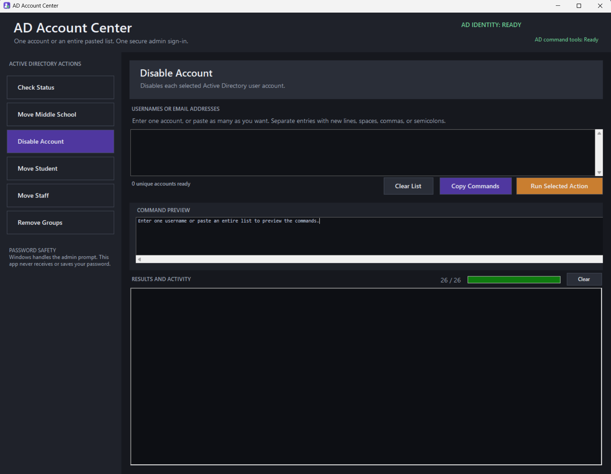

# AD Account Center

A Windows desktop app (PowerShell + WinForms) for running bulk Active Directory account actions on a pasted list of users, without remoting into a domain controller.

Paste one username or a list of hundreds, pick an action, review the exact commands, confirm, and watch results stream in per account.



*Screenshot from the original in-house version; the public version renames "Move Middle School" to a configurable "Move to OU".*

## The problem

Routine account work, like disabling departing users, moving students to a new class OU at the start of a year, or stripping group memberships before an account is retired, meant remoting into the server and running the same command-line tools account by account. That's slow, easy to get wrong when you're copying and pasting dozens of distinguished names, and hard to hand off to anyone else.

## What it does

| Action | What happens |
| --- | --- |
| Check Status | Finds each account by email and shows its distinguished name, OU and disabled state |
| Move to OU | Moves accounts to a destination OU chosen from a dropdown (configured list) |
| Disable Account | Disables each account |
| Move Student / Move Staff | Moves accounts into the student or staff disabled-accounts OU |
| Remove Groups | Removes every group membership; Domain Users stays as the primary group |

## Safety by design

These are tools that can disable or move hundreds of accounts in one click, so the app is built to make mistakes hard:

- **Input validation.** Entries are parsed, de-duplicated and checked before anything runs. Anything that isn't a valid username or an address in the configured domain is rejected and listed.
- **Command preview.** The exact commands for the first few accounts are shown before running, and can be copied to run by hand instead.
- **Confirmation on every change.** Any action that changes accounts shows a confirmation listing the action, destination and accounts affected, with **No** as the default button.
- **Fixed destinations.** OUs come from a config file, not free text, and the worker re-checks the destination before moving anything.
- **Correct identity.** The app checks it is running as the configured admin account and refuses to run otherwise.
- **No password handling.** The launcher uses `runas`, so Windows prompts for the admin password. The app never sees or stores it.
- **Per-account results.** Each account reports success, not found, or error. One failure doesn't stop the batch, and a summary is shown at the end.

## How it works

```
ADAccountCenter.ps1  (WinForms UI)
   │  writes a job file (JSON: action, destination, users)
   ▼
ADAccountWorker.ps1  (separate PowerShell process)
   │  for each user: dsquery → find DN by email → dsmod / dsmove / dsget
   │  appends one JSON result line per account (JSONL)
   ▼
UI polls the results file every 400 ms and updates the log and progress bar
```

The work runs in a separate process so the window stays responsive during large batches, and so a crash in one run can't take down the UI. Temporary job and result files are cleaned up after each run.

Accounts are looked up by the `mail` attribute, which lets staff paste whatever they have: a username (the configured domain is added) or a full email address.

## Setup

Requirements: Windows PowerShell 5.1 and the AD DS command-line tools (`dsquery`, `dsget`, `dsmod`, `dsmove`), included with RSAT: Active Directory Domain Services.

1. Copy `config.example.json` to `config.json` and fill in your domain, admin account, disabled-account OUs and destination OUs.
2. Run `Start-ADAccountCenter.ps1`. Windows prompts for the admin account's password, then the app opens.

`config.json` is git-ignored so real domain details never get committed.

## Possible improvements

- Port the worker from the legacy `ds*` tools to the ActiveDirectory PowerShell module (`Get-ADUser`, `Move-ADObject`, `Disable-ADAccount`, `Remove-ADGroupMember`) for structured output instead of text parsing.
- Export results to CSV for record-keeping.
- Add a dry-run mode that resolves every account without changing anything.

## Tech

PowerShell 5.1 · Windows Forms · Active Directory (dsquery / dsget / dsmod / dsmove) · JSON / JSONL inter-process messaging
